# GameHub — angular-vice-district


> Central de jogos que agrega APIs públicas (RAWG, CheapShark, Reddit, Epic Games e TMDB) com
> scroll suave, preloader cinematográfico e micro-interações em Angular **zoneless** (signals, standalone, OnPush).
> Semana 1 do roadmap · Milestone `m1-vice-district` · Demo pública no GitHub Pages.

O repositório nasceu como campanha cinematográfica **Vice District** e foi reposicionado para
**GameHub** — o produto em produção é a central de jogos descrita abaixo.

---

## Screenshots do Produto

| Tela | Desktop (1440) | Mobile (390) |
|------|----------------|--------------|
| Início | 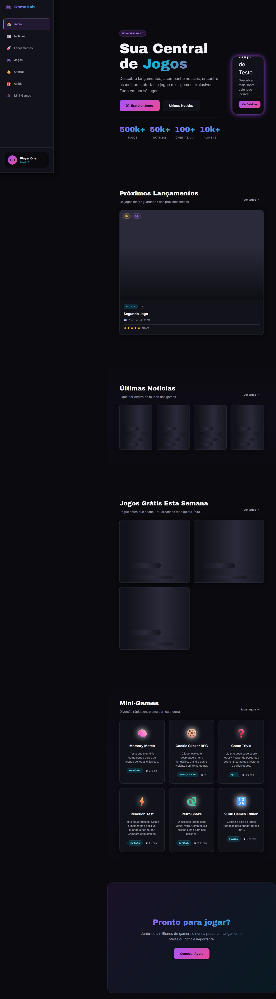 | 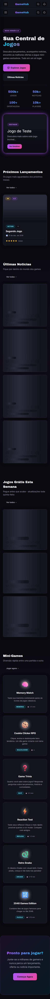 |
| Notícias | 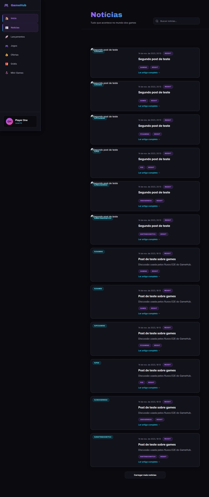 | 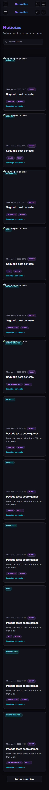 |
| Lançamentos | 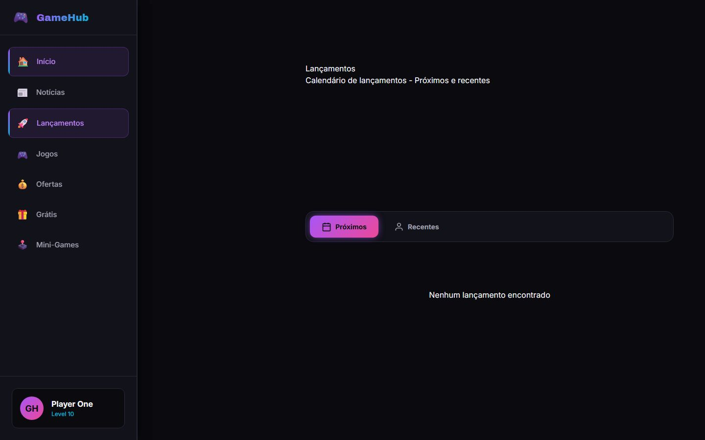 | 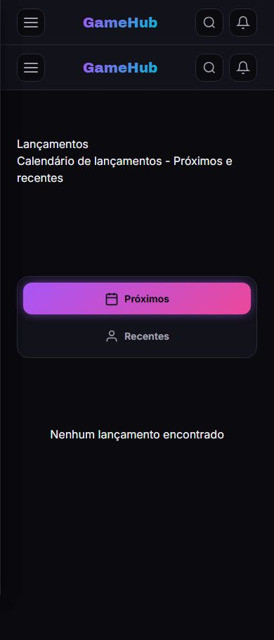 |
| Catálogo de Jogos | 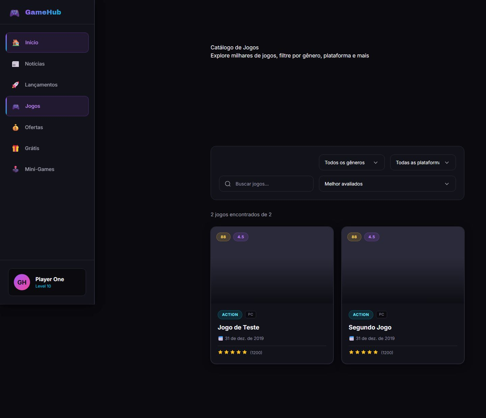 | 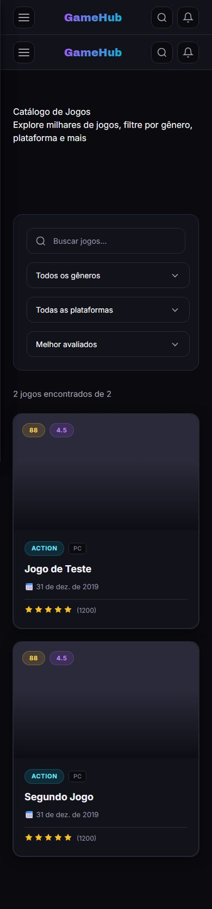 |
| Ofertas | 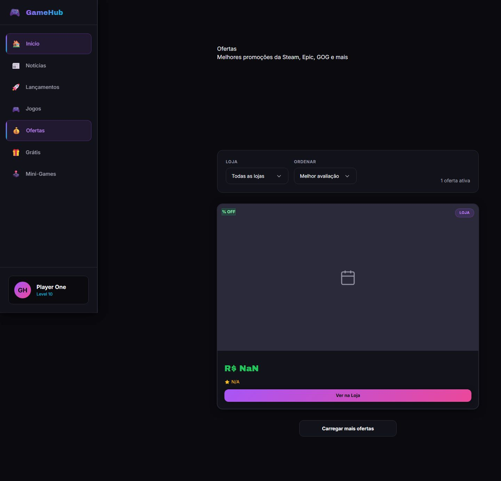 | 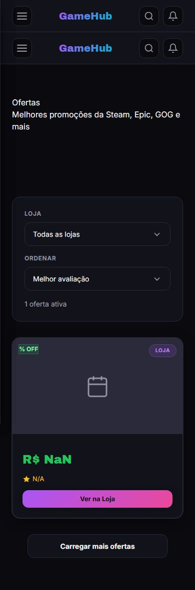 |
| Jogos Grátis | 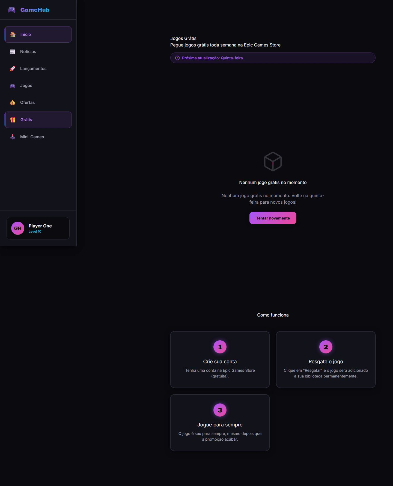 | 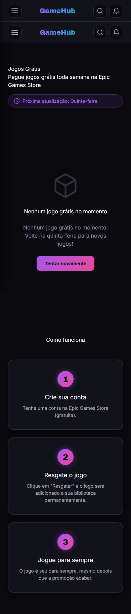 |
| Detalhe do Jogo | 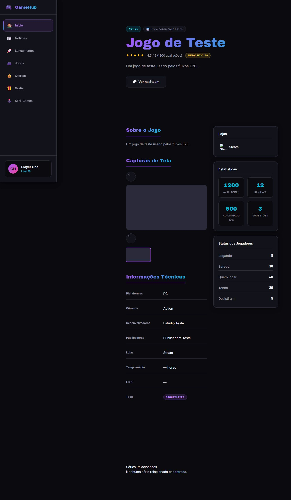 | 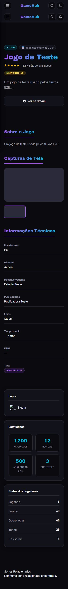 |
| Mini-Games | 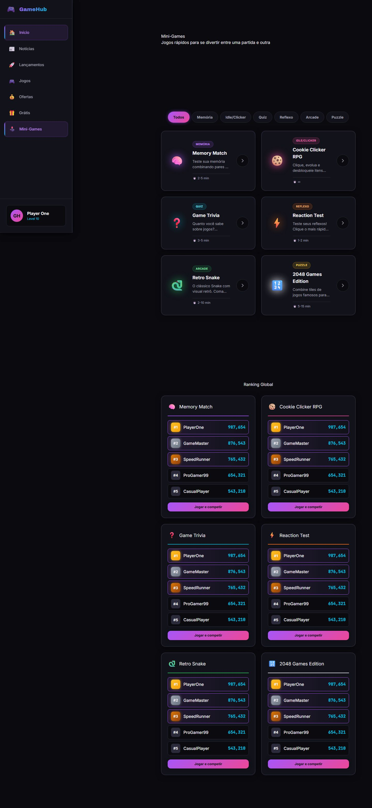 | 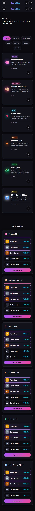 |

> **Baselines:** 16 screenshots (8 telas × desktop/mobile) versionadas em `docs/screenshots/`,
> geradas por `e2e/screenshots.spec.ts` (Playwright). Regerar com `npm run e2e:screenshots`.

---

## Documentação

| Arquivo | Descrição |
|---------|-----------|
| [`docs/vice-district-case.md`](./docs/vice-district-case.md) | Case study: contexto, desafio, solução, métricas e "o que aprendi" |
| [`docs/a11y/relatorio-axe.json`](./docs/a11y/relatorio-axe.json) | Relatório de acessibilidade (axe) das 8 telas |
| [`docs/clarity-integracao.md`](./docs/clarity-integracao.md) | Integração do Microsoft Clarity (mapa de calor) |
| [`docs/manter-online.md`](./docs/manter-online.md) | Estratégia zero-standby (custo zero) |

---

## Setup Rápido

```bash
npm install          # instala dependências
npm start            # ng serve → http://localhost:4200
```

O app **não tem backend próprio**: os dados vêm de APIs públicas (RAWG, CheapShark, Reddit,
Epic Games e TMDB). Sem credenciais ele sobe normalmente — as telas exibem estado vazio ou erro
tratado em vez de quebrar. Os testes E2E mockam essas APIs, então rodam sem rede nem cota.

---

## Comandos Principais

| Comando | Descrição |
|---------|-----------|
| `npm start` | Servidor de desenvolvimento (`ng serve`) |
| `npm run build` | Build de produção (`ng build`) |
| `npm run lint` | ESLint + angular-eslint |
| `npm test` | Testes unitários (Karma, sem watch) |
| `npm run test:watch` | Testes unitários em watch |
| `npm run test:ci` | Testes unitários + cobertura (CI) |
| `npm run e2e` | Playwright (smoke + axe + screenshots) |
| `npm run e2e:smoke` | Somente o smoke E2E (navegação + a11y) |
| `npm run e2e:a11y` | Varredura de acessibilidade (gera relatório axe) |
| `npm run e2e:screenshots` | Regenera os prints do README |
| `npm run analyze` | Análise de bundle (`ng build --stats-json`) |

---

## Telas Implementadas

| Tela | Rota | Conteúdo |
|------|------|----------|
| Início | `/` | Hero, destaques, lançamentos, últimas notícias, jogos grátis e mini-games |
| Notícias | `/noticias` | Feed de notícias (Reddit/NewsAPI) com busca e "carregar mais" |
| Lançamentos | `/lancamentos` | Próximos lançamentos por data (RAWG) |
| Catálogo de Jogos | `/jogos` | Busca, filtro por gênero/plataforma, ordenação e paginação (RAWG) |
| Ofertas | `/ofertas` | Promoções por desconto (CheapShark) com filtro de loja e ordenação |
| Jogos Grátis | `/gratis` | Jogos gratuitos da Epic Games Store com contagem regressiva |
| Detalhe do Jogo | `/jogo/:id` | Ficha completa do jogo com galeria de screenshots (RAWG) |
| Mini-Games | `/mini-games` | 6 mini-games jogáveis (Memória, Clicker, Trivia, Reflexo, Snake, 2048) + leaderboard |

---

## Qualidade & Performance

| Métrica | Resultado |
|---------|-----------|
| **Unit tests (Karma)** | 135/135 passando (27 arquivos de spec) |
| **Cobertura** | 84,4% statements · 73,0% branches · 76,9% functions · 88,1% lines |
| **E2E (Playwright)** | 26/26 passando (9 smoke + 1 axe + 16 screenshots) |
| **Acessibilidade (axe)** | 0 violações graves/críticas nas 8 telas |
| **Lighthouse** | Performance **86** · A11y **100** · Best Practices **75** · SEO **92** |
| **ESLint** | 0 erros |
| **Bundle inicial** | 297 kB (≈82 kB transfer) |
| **Responsivo** | mobile (390) / desktop (1440) |

> **Best Practices 75** vem dos erros de console das chamadas a APIs públicas sem mock no build
> estático (RAWG/Reddit externos) + cookies de terceiros do Microsoft Clarity. Não é dívida de
> código do app — os mesmos fluxos passam com as APIs mockadas nos testes E2E.

---

## Acessibilidade

Varredura automatizada com `@axe-core/playwright` (tags WCAG 2.0/2.1 A+AA) nas oito telas —
**zero violações** graves ou críticas. Relatório versionado em
[`docs/a11y/relatorio-axe.json`](./docs/a11y/relatorio-axe.json); reproduzir com `npm run e2e:a11y`.

- O grid de cards não usa mais `role="list"`/`role="listitem"` inválido em `<article>` — a estrutura
  fica com a semântica nativa (títulos e `<article>`), o que zerou `aria-allowed-role` e
  `aria-required-children` no Lighthouse.
- O estado vazio de Notícias saiu de dentro do `role="feed"` (o feed só contém `<article>`).
- Contraste do badge de posição do leaderboard corrigido (`--color-text-primary` sobre o fundo do card).
- Alvo de toque, foco visível e `prefers-reduced-motion` respeitados no shell e nos cards.

---

## Design — decisão e intenção

### Conceito

**GameHub** agrega o que um jogador abre em cinco abas — notícias, lançamentos, catálogo, ofertas e
grátis — e ainda entrega mini-games para quebrar o tempo de espera. A linguagem visual é *neon sobre
quase-preto*: energia de fliperama sem sacrificar legibilidade.

### Identidade visual

| Token | Valor | Para quê |
|-------|-------|----------|
| `--color-bg-deep` `#0a0a0f` | preto profundo | Palco escuro que faz os neons saltarem |
| `--color-bg-card` `#12121a` | card escuro | Camada de conteúdo sem "flutuar" no fundo |
| `--color-border` `#2a2a3a` | borda neutra | Separa cards e seções com discrição |
| `--color-text-primary` `#f0f0f5` | off-white | Texto principal — alto contraste |
| `--color-text-secondary` `#a0a0b0` | cinza claro | Metadados e hierarquia secundária |
| `--color-neon-purple` `#a855f7` | roxo neon | Ação primária, marca e destaques |
| `--color-neon-cyan` `#06b6d4` | ciano | Links e acentos informativos |
| `--color-neon-pink` `#ec4899` | rosa | Ofertas e energia de promoção |
| `--color-neon-green` `#22c55e` | verde | "Grátis"/disponível |
| `--color-gold` `#fbbf24` | dourado | 1º lugar, preço e selos |

- **Tipografia:** `Archivo Black` (display) para títulos curtos e impactantes; `Inter` (corpo);
  `JetBrains Mono` para números e código.
- **Formas:** cards com cantos arredondados, bordas sutis e `card-glow-*` no hover; badges coloridas
  por categoria; gradiente de marca roxo→rosa nas CTAs.

### Estratégia de movimento

| Peça | Implementação | Intenção |
|------|---------------|----------|
| Preloader | Progresso reativo em CSS + rede de segurança por timeout | Ritual de entrada, sem prender o visitante |
| Hero | Timeline GSAP de entrada + parallax com `scrub` | Primeira dobra com peso cinematográfico |
| Scroll suave | Lenis integrado ao `ScrollTrigger.update` no mesmo rAF | Remove o "pulo" do scroll nativo |
| Cards | `appReveal` (entrada por viewport) e hover com glow | Sensação de vitrine viva |
| Mini-games | Estados interativos (clique, tempo, ranking) | Retenção sem sair do app |

---

## Dados e conteúdo (sem backend próprio)

- **RAWG** — catálogo, lançamentos e detalhe de jogos.
- **CheapShark** — ofertas e histórico de preço.
- **Reddit / NewsAPI** — notícias de games (sem chave da NewsAPI, o app usa apenas o Reddit).
- **Epic Games Store** — jogos grátis da semana.
- **TMDB** — metadados de cinema usados na home legada.
- **Supabase** — newsletter/leads (modo demo quando não configurado).

> **Pendência conhecida:** a chave da RAWG está fixa no `rawg.service.ts` (demo) e hoje responde
> `401`. Sem chave própria, catálogo/lançamentos/detalhe caem no estado vazio — os E2E mockam a API,
> então continuam verdes. Mover as chaves para `environment`/`.env` é o próximo passo.

---

## Decisão de teste: Karma

> Cada repo do roadmap alterna Karma/Vitest de propósito: agnóstico de ferramenta, escolha por contexto.

Este projeto usa **Karma + Jasmine + ChromeHeadless** porque as telas dependem de DOM e animação
reais: GSAP, Lenis e `getComputedStyle` rodam de verdade no headless, o que pega bugs de foco,
overflow e timing que um ambiente JS puro (jsdom) deixaria passar. O CI roda `npm run test:ci`
(com cobertura) e o Playwright cobre navegação, a11y e screenshots.

---

## Estrutura do Projeto

```text
src/
├─ app/
│  ├─ core/                 # services (rawg, cheapshark, epic, news, cache, lead), models e directives
│  ├─ features/             # páginas do GameHub (lazy): home, news, releases, games, deals,
│  │                        #   free-games, game-detail, mini-games, layout/shell
│  ├─ shared/components/    # game-card, rating e afins
│  ├─ sections/ · pages/    # home legada da campanha Vice District (não roteada)
│  └─ app.routes.ts         # árvore de rotas públicas
├─ environments/            # ambiente.local.ts gerado por scripts/gerar-ambiente.mjs
└─ index.html
e2e/                        # Playwright: smoke, acessibilidade (axe), screenshots + apoio/api-mocks
docs/                       # case study, a11y, screenshots, runbooks
.github/workflows/          # CI (lint→build→unit→e2e) + Deploy (GitHub Pages) + bots diários
```

---

## Stack

| Responsabilidade | Tecnologia |
|------------------|------------|
| Framework | Angular 22 (standalone, signals, zoneless, OnPush) |
| Linguagem | TypeScript 6 |
| Estilização | Tailwind CSS 4 (tokens próprios em `styles.css`) |
| Animação | GSAP + ScrollTrigger · Lenis (smooth scroll) · three.js (home legada, lazy) |
| Dados | APIs públicas (RAWG, CheapShark, Reddit, Epic, TMDB) · Supabase (leads) |
| Testes | Karma + Jasmine (unit) · Playwright + axe (E2E/a11y) |
| Qualidade | ESLint + angular-eslint · Lighthouse CI |
| Deploy | GitHub Pages (site estático) |

---

## Branches & Workflow Git

```text
main      → produção (build estático; push dispara deploy no GitHub Pages)
homolog   → validação/release de PRs (staging)
develop   → integração diária (merges das branches feat/*)
feature   → feat/<assunto> + PR para develop
```

- **Commits:** `feat:`, `fix:`, `test:`, `docs:`, `design:`, `ops:`, `backend:` (Conventional Commits)
- **PRs:** sempre via pull request template; revisados e mergeados por milestone
- **main:** protegida — merge somente via PR
- Rastreabilidade com issues, labels (`feat/test/design/ops/backend`) e milestones

---

## Bots (estação local + CI)

| Bot | O que faz |
|-----|-----------|
| **Testes** (`.github/workflows/bot-testes.yaml`) | Suíte completa diária (lint → build → unit → e2e) com o browser do Playwright instalado |
| **Navegação Humana** (`bots/humano/navegacao-humana.mjs`) | Navega como pessoa real e mantém o app aquecido |
| **Resumo Diário** (`.github/workflows/bot-analise-erros.yaml`) | Consolida as falhas das últimas 24h em UMA issue |

---

## Microsoft Clarity (mapa de calor)

Integração **condicional** via `environment.clarityId` (definido no build de produção). Grava mapa de
calor, scroll, cliques e sessões reais. Ver [`docs/clarity-integracao.md`](./docs/clarity-integracao.md).

---

## Deploy

- **GitHub Pages** (projeto público): `https://zecki1.github.io/angular-vice-district/`
  Workflow [`.github/workflows/deploy-pages.yaml`](./.github/workflows/deploy-pages.yaml) — build com
  `--base-href=/angular-vice-district/` + fallback SPA (`index.html` → `404.html`) + `.nojekyll`.
- **Política do workspace:** projetos públicos → GitHub Pages; projetos privados → Vercel.
- Estratégia zero-standby documentada em [`docs/manter-online.md`](./docs/manter-online.md).

---

## Links Úteis

- **Produção (GitHub Pages):** https://zecki1.github.io/angular-vice-district/
- **Repositório:** https://github.com/zecki1/angular-vice-district
- **Roadmap do portfólio:** `planejamento-projetos.md` (Semana 1 — Vice District/GameHub)

---

## Licença

MIT — ver [`LICENSE`](./LICENSE).
